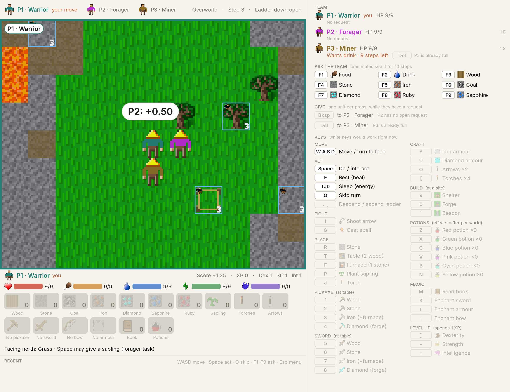

# Alem Play-with-Human-Interface Guide

`examples/play_with_human_interface.py` runs the standard [evaluation protocol](EVALUATION.md)
with humans at the keyboard instead of an agent, so a human baseline is directly
comparable to the RL/LLM leaderboard numbers. It reuses the same trajectory/state
saving code as the LLM/RL eval harness (`alem.trajectory_io`), so all three
tracks' episodes can be loaded and replayed with the same tooling.

## Standard settings

Matches [`EVALUATION.md`](EVALUATION.md) so human runs are comparable to agent
runs on the leaderboard — don't change these for a result you intend to compare.

| Setting | Value | Flag |
| --- | --- | --- |
| Agents | 3 | `--players` |
| Soft specialisation | on | (baked in) |
| Shared reward | off | (baked in) |
| Max steps / episode | 10000 | `--max-steps` |
| Eval seed base | 9999 | `--seed-base` |
| Coordination difficulty | `easy`, `medium`, or `hard` | `--coord` |

Episode `i` in a session uses world seed `seed-base + i` — the identical worlds
agents were scored on. Run one session per participant/team per difficulty you
want to report.

## Before you start

1. **Consent script.** `play_with_human_interface.py` prints a placeholder consent notice and
   records a single console y/N reply that covers everyone hotseating on the
   keyboard — it is **not** an approved IRB/ethics form. Get your institution's
   actual approved consent text and either read it aloud before running the
   tool, or edit `_CONSENT_SCRIPT` in `play_with_human_interface.py` to show it
   on-screen. Consent is collected before any file is written; declining exits
   with nothing recorded. After consent, the optional demographics questions
   (age range, gaming experience, survival-game familiarity) are asked once
   per player (`--players`), one after another, so each hotseat player answers
   for themself.
2. **Anonymous ids.** Use an anonymous participant/team id (e.g. `T01`), never a
   real name — `--participant` becomes part of the output directory name and
   every logged record.
3. **A short pilot run.** Try `--max-steps 500` or so on yourself first to check
   controls, framerate, and that files land where you expect, before running a
   real participant at the full 10000-step cap.
4. **Smoke-test the pipeline**, not a real session, with `--bot --headless` (see
   below) — it drives random actions with no display, useful for CI or after
   changing this file. On a machine with a single GPU that also drives the
   desktop, force `JAX_PLATFORMS=cpu` for headless smoke tests to avoid the
   video driver fighting JAX for VRAM.
5. **Print the handout.** `examples/participant_handout.md` (and the `.pdf` next
   to it) is the exact briefing the game shows on screen — the agents' game
   rules plus the keyboard reference — so each player can keep a copy at the
   desk. Regenerate it after changing the rules or controls:

   ```bash
   python -c "import sys; sys.path.insert(0, 'examples'); from play_with_human_interface import build_rules_text; print('# Alem — participant handout\n\n' + build_rules_text(3, True))" > examples/participant_handout.md
   ```

## Running a session

```bash
# A 3-human team (or one human hot-seating all three), 2 episodes on easy:
python examples/play_with_human_interface.py --participant T01 --coord easy --episodes 2

# A short practice round first, so the team learns the controls before it counts:
python examples/play_with_human_interface.py --participant T01 --coord easy --episodes 2 --practice

# Pilot yourself with a shorter episode cap:
python examples/play_with_human_interface.py --participant pilot --coord medium --max-steps 2000

# Verify the whole pipeline with a random bot, no display needed:
JAX_PLATFORMS=cpu python examples/play_with_human_interface.py --bot --headless --episodes 2 --max-steps 50
```

Hotseat flow: players take turns on one keyboard; the world advances once every
player has acted. The player whose turn it is is boxed in the top bar, named in
the chip at the top-left of the map, and the map is centred on them and framed
in their colour. For a genuine coordination session, seat one human per player
at the same keyboard and allow them to talk — that's the human analogue of the
game's communication channel.

Before the first episode, participants see the same `<game_rules>` briefing the
LLM agents receive (also saved to `rules.txt` in the session directory), plus a
keyboard reference. Skip the on-screen page with `--skip-rules` if you brief
participants yourself instead.

The window sizes itself to the largest block size that fits the screen (64 px
blocks on a 1080p display, 128 px on a 4K one); force a size with `--size 64`
or `--size 128`. Holding a key keeps acting, player after player, which is handy
when one person hot-seats all three roles; pass `--no-key-repeat` when each seat
has its own human, so a held key cannot spill into the next player's turn.

## What's on screen



Every panel is drawn from the same game state the agents see; nothing on screen
reveals information an LLM or RL agent would not get in its observation.

**Top bar.** One chip per player in that player's sprite colour (the same colour
as their character on the map) with their role; the current player is boxed and
marked *YOUR MOVE*. On the right: the floor, the step count, and how many
monsters have been killed on this floor out of the 8 that open the ladder down.

**Map.** The 9×11 view centred on the current player, framed in their colour,
with a chip naming them (or saying they are *ASLEEP* / *DOWNED*, in which case
their turn is skipped automatically). Short flashes at the top of the map report
rewards, damage and achievements as they happen. Borders on the map carry the
coordination rules:

| On the map | Meaning |
| --- | --- |
| Green border + number | Soft coordination: works alone, but that many players acting on it in the same step earn a bonus |
| Cyan border + number | Hard coordination: nothing happens unless that many players act on it in the same step |
| Orange dashed border | Handover: one player starts it, another must finish it within the window |
| Red silhouette + gold tint on a creature | Elite creature that needs coordinated attacks (the *Facing* line says whether it is soft or hard) |
| Number badge on a bordered block | How many players it needs |

**Status strip (below the map)** — everything about *you*, the current player:

- *YOU P1 · Warrior*, your score, XP and attribute levels, plus a tag if you are
  asleep, resting, downed, or have a request open (with its countdown).
- Stat bars with exact values: HP, food, drink, energy, mana. A value turns red
  when it is critically low.
- Inventory with names and counts: materials (wood … arrows) always shown, and a
  second row for your pickaxe and sword tier, bow, armour pieces, book, learned
  spell and any potions you hold. Empty slots are dimmed rather than hidden.
- **Facing** line: what is on the tile in front of you and what it needs — the
  coordination rule (soft / hard / handover, how many players, how many steps
  are left on a handover someone started), the pickaxe tier a block needs,
  whether a ladder is open or how many kills are still needed, and for a
  creature whether it is an elite and the rule for attacking it. This is the
  same information the text observation gives LLM agents.

**Event log (bottom-left).** The last few rewards, damage events and achievement
unlocks, so a player who was looking at the keyboard can catch up. Key hints sit
to its right.

**Sidebar — TEAM.** Each player with their colour, role, HP and status
(*asleep* / *resting* / *DOWNED*), their position relative to you, and their
open request (*wants DRINK · 7 steps left*). Next to a teammate's request is
the **Give key that reaches them** from your seat, drawn white when pressing it
would transfer a unit right now, otherwise faded with the reason it would not
(*you have no drink*, *P3 is already full*, *you are asleep*).

**Sidebar — ASK THE TEAM.** The nine request keys with the resource icon:
`F1` Food, `F2` Drink, `F3` Wood, `F4` Stone, `F5` Iron, `F6` Coal, `F7` Diamond,
`F8` Ruby, `F9` Sapphire. A request can be made at any time, teammates see it for
10 steps, and your own open request is highlighted here with its countdown.

**Sidebar — GIVE.** `Backspace` and `Delete`, each labelled with the teammate it
reaches from your seat (P1: `Backspace`→P2, `Delete`→P3; P2: `Backspace`→P1,
`Delete`→P3; P3: `Backspace`→P1, `Delete`→P2). Each press gives one unit of
whatever that teammate requested; the key is white when it would work.

**Sidebar — ACTIONS.** Every remaining key in two columns, grouped (move, act,
place, pickaxe, sword, craft, fight, build, potions, magic, level up), with an
icon of what it makes or uses. A key is drawn **white when that action would
succeed this turn** (e.g. *Make Wood Pickaxe* next to a table with wood in
hand) and fades into the background otherwise, so players can see both the
key and whether it works without memorising recipes. Potion rows show how many of each
colour you hold; the potion effects are shuffled per world, so test them when
safe.

### Controls

| Action | Key(s) |
| --- | --- |
| Move / turn to face (N/W/S/E) | `W` `A` `S` `D` |
| Do / interact with the faced tile | `Space` |
| Sleep (energy) / Rest (health) / Skip turn | `Tab` / `E` / `Q` |
| Descend / Ascend a ladder (whole team moves) | `.` / `,` |
| Place stone / table / furnace / sapling / torch | `R` `T` `F` `P` `J` |
| Craft pickaxe (wood / stone / iron / diamond) | `1` `2` `3` `4` |
| Craft sword (wood / stone / iron / diamond) | `5` `6` `7` `8` |
| Craft iron armour / diamond armour | `Y` / `U` |
| Craft arrows / torches | `O` / `[` |
| Shoot arrow / cast spell | `I` / `G` |
| Drink potion: red / green / blue / pink / cyan / yellow | `Z` `X` `C` `V` `B` `N` |
| Read book / enchant sword / enchant armour / enchant bow | `M` `K` `L` `;` |
| Level up dexterity / strength / intelligence (1 XP each) | `]` `-` `=` |
| Ask the team for food / drink / wood / stone / iron / coal / diamond / ruby / sapphire | `F1` … `F9` |
| Give 1 unit to the lower- / higher-numbered other player (needs their open request) | `Backspace` / `Delete` |
| Build shelter / forge / beacon at a construction site | `9` `0` `` ` `` |
| Start next episode | `Enter` |
| Pause menu | `Esc` |

## Pausing, saving, and resuming

Press **Esc** at any point during an episode to open the pause menu:

- **Resume** — close the menu, keep playing.
- **Save Checkpoint** — write a checkpoint without stopping (also happens
  automatically after every completed round of play, so accidental closes lose
  at most one round).
- **Reload Last Checkpoint** — discard everything since the last checkpoint and
  continue from there. Useful if the team wants to retry a section.
- **Save & Quit** — checkpoint, then end the process. Resume later.
- **Abort Episode** — end this episode now (recorded `status=aborted`, scored
  as-is); the team moves on to the next episode or ends the session.
- **Quit Without Saving** — close immediately.

To resume a session that was saved-and-quit, interrupted (Ctrl+C), or crashed,
point `--resume` at its output directory:

```bash
python examples/play_with_human_interface.py --resume outputs/play_with_human_interface/T01_easy_20260725-153000
```

`--resume` restores the original protocol (participant, difficulty, seeds,
episode count) from `session.json` — you don't repeat any flags — and picks up
at the first episode that never reached a final (`completed`/`aborted`) state,
replaying its logged actions to reconstruct the in-progress episode exactly
before handing control back to the player. Consent and the rules screen are not
shown again on resume.

Checkpoints are tiny (a JSON bookmark, not a full state snapshot) because Alem
is a deterministic function of `(world seed, action sequence)` — resuming
always works by replaying the actions already logged in `steps.jsonl`, never by
loading a saved simulator state. One known limitation: an episode's reported
`duration_s` only covers wall-clock time within a single process, so it resets
across a `--resume` (env step counts and all other data are unaffected).

## Output files

Every session writes to `outputs/play_with_human_interface/<participant>_<coord>_<timestamp>/`:

| File | Contents |
| --- | --- |
| `session.json` | Participant id, consent/demographics, full protocol config, git commit, library versions |
| `rules.txt` | The exact briefing text shown to the participant |
| `steps.jsonl` | One record per env step: per-player action + decision latency (ms), rewards, health/food/drink/energy, positions, achievement unlocks |
| `episodes.jsonl` | One record per episode: status, duration, env steps, and the canonical `compute_score()` metrics (leaderboard-comparable) |
| `episode_XX_trajectory.npz` | Symbolic obs/actions/rewards/dones for episode `XX`, same format `alem.trajectory_io` uses for LLM/RL eval episodes |
| `episode_XX_states.pkl.gz` | Full env-state snapshot per step, for exact replay |
| `episode_XX_checkpoint.json` | Present only while an episode is mid-flight and unfinished; deleted once it completes or is aborted |

Practice episodes use the tag `practice` instead of a zero-padded index (e.g.
`episode_practice_trajectory.npz`) and are excluded from `--aggregate` and
`--export-csv`.

Everything is flushed to disk as it's written (line-buffered JSONL), so a crash
or `Ctrl+C` loses at most the current in-progress step.

## After collecting data

```bash
# Mean ± std per coordination difficulty, across every session under --out:
python examples/play_with_human_interface.py --aggregate

# Flat CSV of every episode, for R/pandas/etc.:
python examples/play_with_human_interface.py --export-csv outputs/play_with_human_interface/episodes.csv
```

Both read every `episodes.jsonl` under `--out` (default `outputs/play_with_human_interface/`)
and need no JAX/pygame imports, so they're fast even over many sessions.

The leaderboard columns are the reward-normalised team metrics — **Total%**
`Team/reward_pct_of_max`, **Coord.%** `Team/coord_reward_pct_of_max`, **Base%**
`Team/normal_reward_pct_of_max` — which the runner prints as the "eval metrics"
line after every episode and session. `Team/achievement_pct` (and its
coordination/normal variants) is the achievement-count view of the same run:
report it alongside, but it is **not** the leaderboard number and differs from it
by roughly a factor of two — see [`EVALUATION.md`](EVALUATION.md#headline-metric).

Back up the whole `outputs/play_with_human_interface/` directory (or each session directory)
after every session visit — it's the only copy of the raw data.

## Reviewing a session

`examples/replay_play_with_human_interface.py` plays back a saved episode from its
`*_states.pkl.gz` file — for spot-checking that nothing was corrupted by a
save/reload, or producing a clip for a talk. It uses the same window as live
play, so a replay shows every panel a participant saw:

```bash
# Interactively view episode 0 of a session (space=play/pause, arrows=step/speed, P=player, Q/Esc=quit):
python examples/replay_play_with_human_interface.py outputs/play_with_human_interface/T01_easy_20260725-153000 --episode 0

# Export a GIF instead (works headless, no display needed):
python examples/replay_play_with_human_interface.py <session_dir> --episode 0 --headless --save-gif out.gif
```

## Checklist for a play session visit

1. Approved consent text ready (replace the placeholder — see above).
2. Confirm `--coord`, `--episodes`, and `--players` match your protocol before
   the first participant, not after.
3. Put a printed `examples/participant_handout.pdf` next to the keyboard.
4. Run `--practice` first so the team learns the controls before anything is
   scored.
5. Mention Esc is the pause menu, not an abort — the old play-testing habit of
   mashing Esc to quit will otherwise save/reload data unexpectedly.
6. After the session, spot check with `replay_play_with_human_interface.py`, then back up the
   output directory.
7. Once all visits are done: `--aggregate` for a quick look, `--export-csv` for
   stats software.
